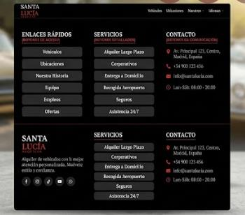
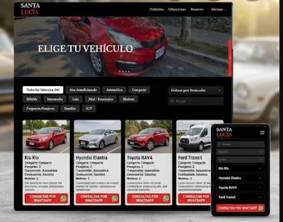

# Santa Lucía Alquiler (Renta Cars Santa Lucía)

Sistema web de renta de vehículos que permite consultar la flota, realizar reservas, administrar el catálogo, registrar mantenimientos y consultar reportes. Proyecto de cátedra de la asignatura *Desarrollo de Aplicaciones Web con Software Interpretados en el Cliente*, Facultad de Ingeniería, Universidad Don Bosco (UDB).

**Aplicación desplegada:** https://alquiler-autos4-k6kb-7sjsifg7r-steven-aparicio.vercel.app/
**Diseño en Figma:** 

---

## Integrantes

| Integrante | Carnet | Rol en la entrega final | Rama | GitHub |
|---|---|---|---|---|
| Asael Enrique López Ramírez | LR260119 | [COMPLETAR] | `[rama]` | [@asael-lopez](https://github.com/asael-lopez) |
| Diego Alejandro Castro Ponce | CP262584 | [COMPLETAR] | `[rama]` | [@usuario](https://github.com/usuario) |
| José Arnulfo Rauda Ramirez | RR230462 | [COMPLETAR] | `[rama]` | [@usuario](https://github.com/usuario) |
| Steven Alejandro Ayala Aparicio | AA220466 | Despliegue, repositorio y licencia | `[rama]` | [@usuario](https://github.com/usuario) |

Roles de la entrega final: (1) despliegue, repositorio y licencia; (2) framework JS y diseño UX/UI; (3) API externa y módulos; (4) reportes y revisión final.

## Problema que resuelve

Renta Cars Santa Lucía es un negocio local de alquiler de vehículos cuyo proceso de atención es totalmente manual: el cliente debe contactar al encargado para conocer los vehículos disponibles, los precios y las condiciones del contrato. Como esa información no está centralizada en línea, el personal pierde tiempo atendiendo consultas de personas que desisten al conocer las tarifas, y a los clientes les cuesta identificar rápido qué vehículo se ajusta a su número de pasajeros, tipo de carrocería o presupuesto.

La aplicación web expone la flota, los modelos y los precios de forma clara, y ofrece una base de gestión digital con datos clave para la administración del negocio.

## Módulos del sistema

**Principales**
- **Fleet (Nuestra flota):** consulta de vehículos por categoría y reserva desde cada tarjeta, con validación de fechas, detección de reservas traslapadas y cálculo del monto con servicios adicionales (seguro, GPS y silla para bebé).
- **Dashboard (Panel de control):** indicadores clave (flota total, reservas, ingresos y eficiencia) que cambian según el rol activo (administrador o cliente).
- **Reports (Reportes):** rendimiento mensual de la flota con gráfica dinámica de barras (ingresos y número de reservas) y tabla de desglose mensual. Acceso restringido a administradores.

**Secundarios**
- [COMPLETAR: por ejemplo, administración del catálogo, registro de mantenimientos, login y registro.]

## Tecnologías

- **React 19** con **Vite**
- **Context API** y Hooks (`useState`, `useEffect`) para el estado global, con persistencia en `localStorage`
- **Chart.js** con **react-chartjs-2** para las gráficas dinámicas
- **API externa:** [Nominatim](https://nominatim.org/) (OpenStreetMap) para convertir direcciones en coordenadas
- **Leaflet** y teselas de OpenStreetMap para los mapas
- **lucide-react** (íconos) y **SweetAlert2** (modales y confirmaciones)
- **ESLint** para el análisis estático
- Hosting: Vercel.

## Mockups

Los mockups de la Etapa 1 se diseñaron en Figma: [COMPLETAR: enlace, si se encuentra].

| Vista | Mockup |
|---|---|
| Catálogo y barra de filtros |  |
| Pie de página y canales de contacto |  |

## Cómo ejecutar el proyecto en local

```bash
git clone https://github.com/asael-lopez/ALQUILER-autos4.git
cd ALQUILER-autos4
npm install
npm run dev
```

Para generar la versión de producción:

```bash
npm run build
```

## Organización del repositorio

- `main`: versión estable, de donde sale el despliegue.
- Una rama por integrante, con sus propios commits.

## Créditos

Mapas y búsqueda de direcciones: © [OpenStreetMap contributors](https://www.openstreetmap.org/copyright).

## Licencia

Este proyecto está bajo la licencia **Creative Commons Atribución 4.0 Internacional (CC BY 4.0)**. Consulta el archivo [LICENSE](LICENSE) o https://creativecommons.org/licenses/by/4.0/deed.es
